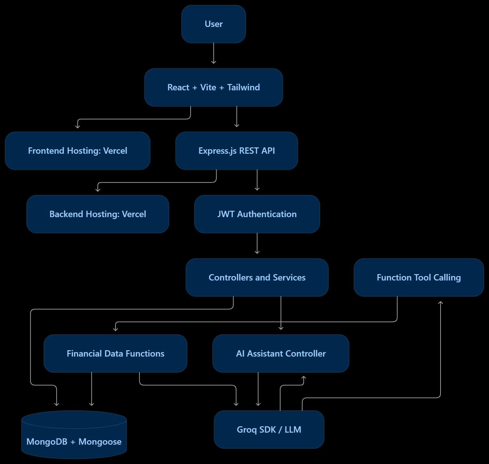

<div align="center">

# 💰 FinMate – AI Finance Tracker

**Track your money. Understand your spending. Chat with your finances.**


</div>

---

## 📖 About

FinMate is a full-stack personal finance tracker that lets you record income and expenses, visualize spending habits, and chat with an AI assistant powered by the **Groq SDK**. The assistant uses **function calling** to run **MongoDB aggregation pipelines** on your transactions, so its answers come from your real data.

🔗 **Live Backend:** https://fin-mate-ai-finance-tracker-backend.vercel.app

<!-- 📸 Add a banner or demo GIF here -->
<!--  -->

---

## ✨ Features

- 🔐 **Authentication** – email/password with JWT
- 🔑 **Social login (OAuth 2.0)** – Google and GitHub *(in progress)*
- ➕ **Transaction management** – add, edit, delete income and expenses
- 🗂️ **Categories** – organize and filter spending
- 📊 **Dashboard & analytics** – balance, income vs. expense, category breakdown
- 🤖 **AI finance chat (Groq)** – ask questions about your spending in natural language
- 🧮 **Function calling + MongoDB aggregation** – the LLM picks a tool, the server runs a safe aggregation pipeline, and the LLM explains the result
- 💡 **Smart insights** – AI-generated tips and summaries
- 📱 **Responsive UI** – desktop, tablet, and mobile

---

## 🏗️ Architecture

### System Architecture



### AI Chat Flow


---

## 🤖 How the AI Chat Works

FinMate does not send your raw data to the LLM. It uses **function calling** so the model only decides *which* query to run, and your server runs it.

1. The user asks a question, e.g. *"What were my top 3 expense categories this month?"*
2. The server sends the message to **Groq** along with a list of **tool definitions** (function names, descriptions and JSON-schema parameters).
3. The model replies with a **tool call**, such as `getTopCategories({ month: "2026-10", limit: 3 })`.
4. The server validates the arguments and builds a **MongoDB aggregation pipeline**, always scoped to the logged-in `userId`.
5. The result is sent back to Groq as a tool message, and the model writes the final answer.

**Why this design**

- ✅ Answers are computed from real data, not guessed by the model
- 🔒 The model never writes raw queries. Only predefined, validated pipelines run
- 👤 Every pipeline is filtered by `userId`, so users only see their own data
- ⚡ Only small aggregated results go to the LLM, which saves tokens

---

## 🛠️ Tech Stack

| Layer        | Technologies                                   |
| ------------ | ---------------------------------------------- |
| Frontend     | React, Tailwind CSS, Axios                     |
| Backend      | Node.js, Express.js                            |
| Database     | MongoDB, Mongoose (aggregation pipeline)       |
| AI           | **Groq SDK** (function calling)                |
| Auth         | JWT, bcrypt, OAuth 2.0 (Google, GitHub)        |
| Deployment   | Vercel                                         |

---

## 📁 Project Structure

```
FinMate-AI-Finance-Tracker/
├── client/          # Frontend app
├── server/          # Backend API
├── assets/          # Architecture diagrams & screenshots
└── README.md
```

---

## 🚀 Getting Started

### Prerequisites

- Node.js v18+
- npm or yarn
- MongoDB (local or [Atlas](https://www.mongodb.com/atlas))
- A Groq API key from the [Groq Console](https://console.groq.com/keys)
- *(Optional)* Google and GitHub OAuth apps – see [OAuth Setup](#-oauth-setup)

### 1. Clone

```bash
git clone https://github.com/Saquib-Anjum/FinMate-AI-Finance-Tracker.git
cd FinMate-AI-Finance-Tracker
```

### 2. Backend

```bash
cd server
npm install
```

Create `server/.env`:

```env
PORT=5000
MONGO_URI=your_mongodb_connection_string
JWT_SECRET=your_jwt_secret
CLIENT_URL=http://localhost:5173

# Groq
GROQ_API_KEY=your_groq_api_key

# OAuth – Google
GOOGLE_CLIENT_ID=your_google_client_id
GOOGLE_CLIENT_SECRET=your_google_client_secret
GOOGLE_CALLBACK_URL=http://localhost:5000/api/auth/google/callback

# OAuth – GitHub
GITHUB_CLIENT_ID=your_github_client_id
GITHUB_CLIENT_SECRET=your_github_client_secret
GITHUB_CALLBACK_URL=http://localhost:5000/api/auth/github/callback
```

```bash
npm run dev
```

### 3. Frontend

```bash
cd client
npm install
```

Create `client/.env`:

```env
VITE_API_URL=http://localhost:5000
```

```bash
npm run dev
```

App runs at `http://localhost:5173`.

---

## 🔑 OAuth Setup

### Google

1. Go to the [Google Cloud Console](https://console.cloud.google.com/apis/credentials)
2. Create an **OAuth client ID** (Web application)
3. Add the authorized redirect URI: `http://localhost:5000/api/auth/google/callback`
4. Copy the Client ID and Secret into `server/.env`

### GitHub

1. Go to **GitHub → Settings → Developer settings → OAuth Apps → New OAuth App**
2. Set the callback URL: `http://localhost:5000/api/auth/github/callback`
3. Copy the Client ID and Secret into `server/.env`

> For production, add your deployed URLs as additional redirect/callback URIs.

---

## 🔌 API Reference

### Auth

| Method | Endpoint                    | Description                  |
| ------ | --------------------------- | ---------------------------- |
| POST   | `/api/auth/signup`          | Register with email/password |
| POST   | `/api/auth/login`           | Log in                       |
| GET    | `/api/auth/google`          | Start Google OAuth           |
| GET    | `/api/auth/google/callback` | Google OAuth callback        |
| GET    | `/api/auth/github`          | Start GitHub OAuth           |
| GET    | `/api/auth/github/callback` | GitHub OAuth callback        |

### Transactions

| Method | Endpoint                | Description          |
| ------ | ----------------------- | -------------------- |
| GET    | `/api/transactions`     | List transactions    |
| POST   | `/api/transactions`     | Create a transaction |
| PUT    | `/api/transactions/:id` | Update a transaction |
| DELETE | `/api/transactions/:id` | Delete a transaction |

### AI

| Method | Endpoint     | Description                          |
| ------ | ------------ | ------------------------------------ |
| POST   | `/api/chat`  | Chat with the Groq finance assistant |
| POST   | `/api/ai/`   | Get AI spending insights             |

---

## 🖼️ Screenshots

| Dashboard | Transactions | AI Chat |
| :-------: | :----------: | :-----: |
|  |  |  |

---

## 🗺️ Roadmap

- [x] Email/password authentication
- [x] Transaction tracking
- [x] Groq-powered AI chat with function calling
- [ ] Google OAuth
- [ ] GitHub OAuth
- [ ] Budget limits and alerts
- [ ] Recurring transactions
- [ ] Export reports (CSV / PDF)
- [ ] Dark mode

---

## 🤝 Contributing

1. Fork the repo
2. Create a branch: `git checkout -b feature/your-feature`
3. Commit: `git commit -m "Add your feature"`
4. Push: `git push origin feature/your-feature`
5. Open a Pull Request

---

## 👤 Author

**Saquib Anjum** – [@Saquib-Anjum](https://github.com/Saquib-Anjum)

<div align="center">

⭐ If you like this project, give it a star!

</div>
